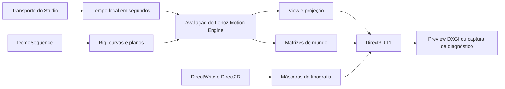

# Arquitetura

## Decisão da primeira fase

C# e .NET 10 LTS no núcleo e no Studio. WinForms fornece HWND, controles de transporte e DPI por monitor. Direct3D 11 e DXGI com Vortice cuidam da projeção, recorte, profundidade e apresentação flip. DirectWrite e Direct2D medem, fazem shaping e rasterizam tipografia em texturas na GPU. HLSL aplica as matrizes e o acabamento. A API gráfica é adequada ao alvo RX 570, sem necessidade de um motor geral de materiais ou de um navegador embarcado. O SDK .NET, as APIs de Windows e os pacotes escolhidos foram verificados no [estudo de upstream](UPSTREAM_RESEARCH.md). [Suporte do .NET](https://learn.microsoft.com/en-us/dotnet/core/releases-and-support), [DXGI flip model](https://learn.microsoft.com/en-us/windows/win32/direct3ddxgi/for-best-performance--use-dxgi-flip-model), [interop Direct2D](https://learn.microsoft.com/en-us/windows/win32/direct2d/interoperability-overview).

Comparação detalhada em [UPSTREAM_RESEARCH](UPSTREAM_RESEARCH.md). C++ com DirectXTK é uma opção de custo nativo similar na GPU e exige outra fronteira para os provedores de mídia e as ferramentas do Studio. Helix agrega uma cena geral e usa SharpDX no caminho WPF avaliado. Three.js tem um renderizador maduro, mas acrescenta o host de navegador para a composição no desktop e uma fronteira extra com SMTC e WASAPI. O custo de interoperabilidade e o uso real do hardware foram critérios junto com manutenção e acabamento.

## Fluxo atual

| Componente | Fronteira e estado |
| --- | --- |
| Lenoz Motion Engine | `src/Lenoz.Motion`, independente de Windows, relógio e GPU. Avalia curvas, caminhos, rig, wiggle e oscilação usando segundos absolutos. |
| Camera Engine | O rig produz a matriz de mundo da câmera. `PerspectiveCamera` calcula a view inversa e a projeção. Dolly, rotação e FOV são canais independentes. |
| Typography Engine | `GlyphMasks` forma uma linha com fonte do sistema e cache por texto, face e tracking. `ScenePlane` retém tamanho em mundo, cor e vínculo ao rig. |
| Procedural Composer | `DemoSequence` gera uma cena a partir de poses, caminhos, fase, opacidade e seed. A demo tem três grupos autorais com tempos locais. Escolha automática de layout ou preset para letras arbitrárias é uma etapa futura. |
| Audio Sync | Futuro adaptador de sessão e relógio monotônico. Fornecerá ID da faixa, duração, posição, velocidade, estado e descontinuidade de seek. Análise musical será uma fonte separada de eventos temporais. |
| Lyrics Provider | Futuro provedor que recebe metadados e retorna cues normalizados por linha e, quando disponíveis, por palavra. Busca, cache, cancelamento e escolha de faixa ficam fora do thread gráfico. |
| Windows Overlay | Futuro host independente do Studio. O renderizador já usa planos com cobertura de alfa. O caminho transparente requer alvo, composição de blur e swap chain com alfa premultiplicado. |
| AE Bridge | Futuro importador de JSON declarativo para canais, IDs, parents, pivôs e convenções de eixo. O leitor de evidência dos testes cobre um subconjunto conhecido dos JSONs locais. |
| Studio | WinForms, relógio de preview, seek, taxa, reinício e métricas. A captura fora da janela e o benchmark instanciam o mesmo renderizador. |

## Render e medição

- Um quad plano por texto ou acento. O DirectWrite gera as métricas tipográficas e o Direct2D gera cobertura em cinza. O raster usa mipmaps e amostragem anisotrópica para reduzir cintilação em perspectiva. Fonte, estilos e tamanhos de raster da demo são fixos.
- A passagem opaca escreve profundidade nos pixels internos da máscara. Bordas e elementos com fade usam mistura premultiplicada, teste de profundidade e ordenação pelo centro em vista. Interseções de superfícies semitransparentes ainda têm limitações de ordenação.
- O preview tem fundo gráfico opaco. Ao habilitar motion blur, o GPU desenha a cena em três amostras no ponto médio de três subintervalos iguais da exposição de 180° a 60 fps e combina os resultados em luz aproximadamente linear. A opção desabilitada libera os alvos adicionais. Como os planos são reavaliados no tempo de cada amostra, os rastros incluem câmera e objetos.
- O relógio é independente do refresh. O Studio espera mensagens do Windows ou o próximo deadline pelo timer de alta resolução e usa `Present(1)`. A sequência avança pelo tempo real, mesmo que um quadro atrase. Ao pausar, só redesenha após alterações e exposições de janela.
- O benchmark mede cadência de submissões, tempos de preparação e `Present` separados, consultas D3D11 de timestamps não blocantes, working set e uso local registrado pelo DXGI. O valor de memória inclui outros recursos do processo alocados pelo driver. [QueryVideoMemoryInfo](https://learn.microsoft.com/en-us/windows/win32/api/dxgi1_4/nf-dxgi1_4-idxgiadapter3-queryvideomemoryinfo).

## Integrações planejadas

O relógio aceita snapshots de GSMTC e converte a posição e a idade do snapshot para uma âncora monotônica. Em pausa e após seek, o novo snapshot substitui a estimativa. Use LRC local e LRCLIB por meio de um contrato único. Faça a seleção por título, artista, álbum e duração e mantenha offsets do usuário por faixa. Timestamps de palavra só habilitam destaque por palavra quando presentes na fonte. [Timeline GSMTC](https://learn.microsoft.com/en-us/uwp/api/windows.media.control.globalsystemmediatransportcontrolssessiontimelineproperties), [LRCLIB](https://lrclib.net/docs).

Spotify, Apple Music e players de YouTube Music são inicialmente candidatos a sessão GSMTC, sujeitos à qualidade da timeline exposta em cada cliente. Um adaptador oficial dedicado depende das permissões, capacidades, termos e disponibilidade do player. A política de desenvolvedores do Spotify tem condições específicas sobre sincronizar seu conteúdo com mídia visual. [Spotify Developer Policy](https://developer.spotify.com/policy), [MusicKit](https://developer.apple.com/musickit/), [YouTube IFrame API](https://developers.google.com/youtube/iframe_api_reference).

WASAPI loopback é candidato para análise de intensidade, transientes e batidas. Use blocos pequenos com carimbo temporal e análise fora do render. Valide a mudança de saída, latência e mistura de sons do sistema antes de usar esses sinais como fonte de timing. [Microsoft WASAPI loopback](https://learn.microsoft.com/en-us/windows/win32/coreaudio/loopback-recording).

O overlay poderá hospedar uma swap chain DXGI de composição com pixel premultiplicado e visual DirectComposition. Validar encaminhamento de input e foco entre processos, DPI, posição virtual de monitores, refresh e modo de apresentação por jogo. Equipes de overlay e exportação poderão compartilhar a projeção e o desenho dos planos e escolher seus próprios alvos. [CreateSwapChainForComposition](https://learn.microsoft.com/en-us/windows/win32/api/dxgi1_2/nf-dxgi1_2-idxgifactory2-createswapchainforcomposition), [DirectComposition](https://learn.microsoft.com/en-us/windows/win32/directcomp/directcomposition-portal).
