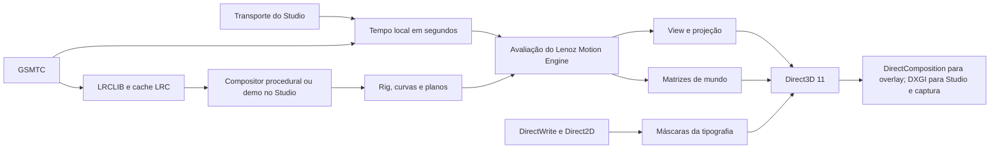

# Arquitetura

## Decisão da primeira fase

C# e .NET 10 LTS no núcleo e no Studio. WinForms fornece HWND e DPI por monitor. Os controles de transporte ficam no Studio. Direct3D 11 e DXGI com Vortice cuidam da projeção, recorte, profundidade e apresentação flip. DirectWrite e Direct2D medem, fazem shaping e rasterizam tipografia em texturas na GPU. HLSL aplica as matrizes e o acabamento. A API gráfica é adequada ao alvo RX 570, sem necessidade de um motor geral de materiais ou de um navegador embarcado. O SDK .NET, as APIs de Windows e os pacotes escolhidos foram verificados no [estudo de upstream](UPSTREAM_RESEARCH.md). [Suporte do .NET](https://learn.microsoft.com/en-us/dotnet/core/releases-and-support), [DXGI flip model](https://learn.microsoft.com/en-us/windows/win32/direct3ddxgi/for-best-performance--use-dxgi-flip-model), [interop Direct2D](https://learn.microsoft.com/en-us/windows/win32/direct2d/interoperability-overview).

Comparação detalhada em [UPSTREAM_RESEARCH](UPSTREAM_RESEARCH.md). C++ com DirectXTK é uma opção de custo nativo similar na GPU e exige outra fronteira para os provedores de mídia e as ferramentas do Studio. Helix agrega uma cena geral e usa SharpDX no caminho WPF avaliado. Three.js tem um renderizador maduro, mas acrescenta o host de navegador para a composição no desktop e uma fronteira extra com SMTC e WASAPI. O custo de interoperabilidade e o uso real do hardware foram critérios junto com manutenção e acabamento.

## Fluxo atual

| Componente | Fronteira e estado |
| --- | --- |
| Lenoz Motion Engine | `src/Lenoz.Motion`, independente de Windows, relógio e GPU. Avalia curvas, caminhos, rig, wiggle e oscilação usando segundos absolutos. |
| Camera Engine | O rig produz a matriz de mundo da câmera. `PerspectiveCamera` calcula a view inversa e a projeção. Dolly, rotação e FOV são canais independentes. |
| Typography Engine | DirectWrite forma as palavras e expõe o mapa de clusters. Direct2D rasteriza contornos em atlas por palavra. D3D11 anima a posição dos clusters com instancing. O demo e o replay de referência usam máscaras de linha. |
| Procedural Composer | ProceduralSong monta perfis de travessia lateral, mergulho e pivô em estações XYZ. Cada frase tem rig e enquadramento próprios. Cada palavra herda a pose global e tem entrada e acento no tempo do vocal. |
| Audio Sync | `LivePlayback` seleciona a sessão GSMTC e converte posição, carimbo e velocidade em uma âncora monotônica. Para o Spotify desktop, NAudio lê o estado da sessão de áudio local se o player publicar `Playing` durante uma pausa. |
| Lyrics Provider | Ler Enhanced LRC preserva tempos por palavra quando presentes. A rota por linha é padrão, com estimativa opcional. Arquivos locais por faixa têm prioridade sobre o LRCLIB. A consulta e o cache ficam no worker. |
| Windows Overlay | Host preferencial. Swap chain de composição com alfa premultiplicado, visual DirectComposition em janela layered topmost, saída transparente e feather aplicado ao RGBA composto. Sombra por glifo em pixels de tela. |
| AE Bridge | O leitor de referência reproduz apenas a cadeia de câmera da auditoria. O bridge geral continuará sendo um importador declarativo para canais, IDs, parents e eixos. O teste usa também matrizes e projeções medidas no AE. |
| Studio | WinForms, relógio de preview, seek, taxa, reinício e métricas. A captura fora da janela e o benchmark instanciam o mesmo renderizador. |

## Render e medição

- Um quad plano por texto ou acento. O DirectWrite gera as métricas tipográficas e o Direct2D gera cobertura em cinza. O raster usa mipmaps e amostragem anisotrópica para reduzir cintilação em perspectiva. Fonte, estilos e tamanhos de raster da demo são fixos.
- A passagem opaca escreve profundidade nos pixels internos da máscara. Bordas e elementos com fade usam mistura premultiplicada, teste de profundidade e ordenação pelo centro em vista. Interseções de superfícies semitransparentes ainda têm limitações de ordenação.
- O Studio tem fundo gráfico opaco e o overlay limpa o alvo RGBA em zero. Ao habilitar motion blur, o GPU desenha a cena em três amostras no ponto médio de três subintervalos iguais da exposição de 180° a 60 fps e combina os resultados em luz aproximadamente linear. A opção desabilitada libera os alvos adicionais. Como os planos são reavaliados no tempo de cada amostra, os rastros incluem câmera e objetos.
- O relógio é independente do refresh. O Studio espera mensagens do Windows ou o próximo deadline pelo timer de alta resolução e usa `Present(1)`. A sequência avança pelo tempo real, mesmo que um quadro atrase. Ao pausar, só redesenha após alterações e exposições de janela.
- O benchmark mede cadência de submissões, tempos de preparação e `Present` separados, consultas D3D11 de timestamps não blocantes, working set e uso local registrado pelo DXGI. O valor de memória inclui outros recursos do processo alocados pelo driver. [QueryVideoMemoryInfo](https://learn.microsoft.com/en-us/windows/win32/api/dxgi1_4/nf-dxgi1_4-idxgiadapter3-queryvideomemoryinfo).

## Reprodução automática

O worker consulta a sessão do Windows a cada 250 ms e confirma a identidade da faixa em amostras consecutivas antes de consultar letras. Uma faixa nova invalida o quadro e cancela a consulta anterior. A posição é projetada pelo tempo monotônico local e um snapshot mais novo pode reposicionar a cena inclusive para trás. Quando uma sessão Spotify local previamente ativa fica inativa com GSMTC ainda em `Playing`, o relógio congela entre as duas amostras observadas. A retomada continua dessa âncora até chegar um carimbo novo. O fallback lê estado do stream WASAPI e dispensa amostragem de áudio. [Timeline GSMTC](https://learn.microsoft.com/en-us/uwp/api/windows.media.control.globalsystemmediatransportcontrolssessiontimelineproperties) · [Estado da sessão de áudio](https://learn.microsoft.com/en-us/windows/win32/api/audiosessiontypes/ne-audiosessiontypes-audiosessionstate).

LRCLIB usa HTTPS identificado, com prazo limite, cancelamento e respeito a `Retry-After`. O cache de até 256 registros hashados grava em arquivo temporário e troca atomicamente. Acertos duram 30 dias, ausências confirmadas duram 20 minutos e erros transitórios permitem nova tentativa. O compositor prepara curvas no worker. O render usa blocos de quatro cues com vizinhos e reutiliza o dispositivo. Prepara até uma textura nova do bloco seguinte por quadro e libera estilos fora do bloco ao avançar. A animação para de apresentar quadros em regiões sem texto e durante pausa. [Documentação do LRCLIB](https://lrclib.net/docs.txt).

## Enquadramento e aparência

O layout usa os avanços dos clusters e reserva a abertura máxima de tracking. O centro óptico e os limites vêm dos contornos projetados no viewport real. O enquadramento aplica escala e translação no espaço de projeção da frase, preservando Z, W e o rig de câmera. A escala nominal permanece fixa durante a leitura, com reavaliação de segurança a cada amostra. Ao redimensionar, o render recalcula margens e quebras de linha. Nas transições, a correção decai e devolve o movimento à trajetória original.

A palavra ativa controla cor, tracking local, escala e halo. O shader combina duas escalas de brilho sobre uma máscara de glifos com alpha e mantém a sombra da sobreposição. A aparência resolve cores e fontes ao montar a faixa. A escolha de preset e o arquivo personalizado são preferências locais independentes. A seleção da aparência recompõe a faixa pelo cache e preserva a âncora da reprodução.

## Integrações planejadas

A primeira integração foi verificada no Spotify desktop. Apple Music e YouTube Music são candidatos a sessão GSMTC, sujeitos à qualidade da timeline publicada por cada cliente. Um adaptador oficial dedicado depende das permissões, capacidades, termos e disponibilidade do player. A política de desenvolvedores do Spotify tem condições específicas sobre sincronizar seu conteúdo com mídia visual. [Spotify Developer Policy](https://developer.spotify.com/policy), [MusicKit](https://developer.apple.com/musickit/), [YouTube IFrame API](https://developers.google.com/youtube/iframe_api_reference).

WASAPI loopback é candidato para análise de intensidade, transientes e batidas. Use blocos pequenos com carimbo temporal e análise fora do render. Valide a mudança de saída, latência e mistura de sons do sistema antes de usar esses sinais como fonte de timing. [Microsoft WASAPI loopback](https://learn.microsoft.com/en-us/windows/win32/coreaudio/loopback-recording).

O overlay mantém o alvo do monitor primário. A região define viewport e feather dentro dele, e a edição atualiza esses limites sem recriar o dispositivo. O HWND de composição recebe `WS_EX_LAYERED`, `WS_EX_TRANSPARENT` e `WS_EX_NOACTIVATE` e usa `SetWindowPos` com `HWND_TOPMOST`. Enquanto o atalho de três modificadores está pressionado, uma janela auxiliar restrita à região recebe o mouse sem tomar foco. A composição preserva proporção ao redimensionar e grava posição e tamanho nas preferências locais ao soltar. O overlay principal continua pass-through durante a edição. Ainda falta validar DPI misto, monitores adicionais e modos de apresentação de jogos. [CreateSwapChainForComposition](https://learn.microsoft.com/en-us/windows/win32/api/dxgi1_2/nf-dxgi1_2-idxgifactory2-createswapchainforcomposition), [DirectComposition](https://learn.microsoft.com/en-us/windows/win32/directcomp/directcomposition-portal).
